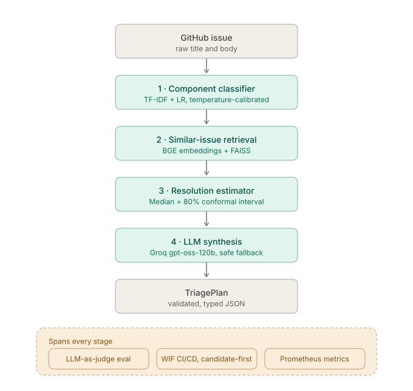

# TriageIQ

**Try it live: [triage-iq-orcin.vercel.app](https://triage-iq-orcin.vercel.app/)**, the web UI over the API below. TriageIQ turns a raw GitHub issue into a structured triage decision: predicted component, similar issues, an expected resolution window, a priority assessment and suggested next steps. It runs a four-stage pipeline (TF-IDF component classifier, BGE + FAISS similar-issue retrieval, resolution-time prediction, LLM synthesis) on real `microsoft/vscode` and `kubernetes/kubernetes` issues and is deployed on Cloud Run. A request takes about 4.8 s when the LLM provider has token headroom (production client p50, n=5); when the free-tier token limits are exhausted it returns a signals-only plan flagged `_degraded` instead of waiting (see [Latency](#latency)). It exists to show a full production ML lifecycle: evaluation with confidence intervals, reproducible builds, Prometheus metrics, fail-closed auth and Workload Identity Federation CI/CD.



---

## Live API

**Base URL:** `https://triageiq-api-1014562031321.us-central1.run.app`

> Served from GCP project `triageiq-prod-260812` (`us-central1`) under an IAM-scoped deploy identity; hosting history and the billing-outage notes are in [`docs/OPERATIONS.md`](docs/OPERATIONS.md#hosting-history).

```bash
# Triage an issue
curl -s -X POST https://triageiq-api-1014562031321.us-central1.run.app/triage \
  -H "Content-Type: application/json" \
  -d '{
    "repo": "microsoft/vscode",
    "title": "Editor crashes when opening large JSON files",
    "body": "VS Code becomes unresponsive on files > 50MB. Reproducible on 1.85.0, Windows 11. No workaround found."
  }' | python -m json.tool
```

**Supported repos:** `microsoft/vscode`, `kubernetes/kubernetes`  
**Rate limits:** 10 requests/hour, 30/day per IP. `/`, `/health`, and `/metrics` are not rate-limited.  
**Latency:** ~4.8s warm p50 end-to-end, ~41s cold start (measured; kept rare by a keep-warm monitor) — details, per-stage numbers and the n=5 caveat in [Latency](#latency).

---

## Headline results

95% intervals in brackets. The full table (every row, comparator and source) is [`docs/EVALUATION.md`](docs/EVALUATION.md); the record of measurement errors found and corrected is [`docs/EVALUATION_HISTORY.md`](docs/EVALUATION_HISTORY.md).

| Stage | Repo | Metric | Result |
|---|---|---|---|
| Component classifier (47 classes) | vscode / kubernetes | Top-3 accuracy, fresh test rows of the 2014–16 corpora (n=423 / 671); 2026 issues: see below | **85.82%** [82.17, 88.82] / **85.99%** [83.16, 88.41] |
| Component classifier | vscode / kubernetes | Top-1 accuracy | 69.98% [65.44, 74.15] / 54.84% [51.06, 58.57] |
| Similar-issue retriever | kubernetes | Recall@5, related task, clean subset (n=66) | **39.39%** [27.3, 51.5] |
| Similar-issue retriever | vscode | Recall@5, duplicate task | **53.50%** [46.5, 60.5] |
| Resolution predictor | kubernetes | Served point estimate: training-window median (ADR-0064); bucket accuracy vs always-majority | 3.04 d; 32.95% [31.29, 34.66] vs 26.0% |
| Resolution predictor | vscode | Served point estimate: training-window median (ADR-0064) | 3.84 d |
| Resolution predictor | kubernetes / vscode | Conformal 80% interval coverage (held-out) | 79.71% [77.94, 81.38] / 82.7% [78.5, 86.2] |
| LLM synthesis (judge /15) | both | Judge mean, regression detector, n=64 | 12.09/15 (80.6%), bootstrap 95% CI [11.64, 12.52] |
| LLM synthesis | both | Component accuracy: predicted equals gold (exact string match) | **68.8% (44/64)**, Wilson 95% [56.6, 78.8] |

Majority-class baseline on the same fresh test rows (always predict the most frequent training class, or the three most frequent for top-3): top-3 28.84% [24.73, 33.33] (vscode) / 43.07% [39.37, 46.85] (kubernetes), top-1 13.71% / 17.73% ([`reports/classifier_majority_baseline.json`](reports/classifier_majority_baseline.json)); the classifier rows above are well clear of it. The resolution rows are compared with the naive median in the full table.

**The vscode classifier on 2026 issues does not hold the number above.** On vscode issues created from 2026-01-01 (temporal test split, n=9,598 eligible labelled issues), scored against the 2026 parent-area taxonomy (ADR-0070; strict rule: a gold label outside the class set is a miss, predicting `other` never a hit), the **served** classifier reaches top-3 **4.4%** [4.0, 4.8] (53.4% under the lenient k8s convention, which is not comparable). Label drift caps any model trained on the old window: only 41.8% [40.9, 42.8] of those issues have a primary label inside the class set (the coverage bound). A retrained candidate, family-only TF-IDF+LR (**not served**), reaches strict top-3 **36.4%** [35.5, 37.4] against that 41.8% bound, in-family top-3 87.0% (n=4,016) and 58.8% under the lenient k8s convention ([`reports/qp1_vscode_phase1_2026-10.json`](reports/qp1_vscode_phase1_2026-10.json)). The retrained k8s `sig/*` candidate (**not served**) reaches top-3 **95.4%** [94.3, 96.5] (n=1,384; strict = lenient, [`reports/qp1_k8s_strict_rescore_2026-10.json`](reports/qp1_k8s_strict_rescore_2026-10.json)).

**Clean request bodies.** The served models were trained on cleaned issue text. Until 2026-10-29 `/triage` passed them the raw request body (a train/serve skew); since then it cleans the body first (`TRIAGE_CLEAN_REQUEST_BODY`, [D91](docs/DECISION_LOG_2026-10.md)). The classifier and retriever figures above are offline evaluations, not live-API measurements.

## How it is evaluated

Each stage is scored on held-out data with Wilson or bootstrap intervals (2000 resamples, seed 42). LLM quality comes from one local judge (`qwen3:8b`) on a 64-issue gold set (vscode n=11, k8s n=53) replayed from a recorded cassette, so CI makes zero live LLM calls. Two caveats matter when reading the LLM rows: the judge's `component_match` is lenient on neighbouring labels, so the exact-match 44/64 above is the number to quote; and the grounding check is a consistency check against the pipeline's own top-3, not a correctness check against gold, because all 20 wrong-component plans still pass it. Details and sources: [`docs/EVALUATION.md`](docs/EVALUATION.md).

---

## Architecture

```
POST /triage {repo, title, body}
        │
        ▼
┌───────────────────────────────────────┐
│ System 1: TF-IDF Component Classifier │  ~6ms p50 (prod, n=5)
│ One-vs-rest LogReg, 47 classes        │
│ vscode top-3 85.8% (top-1 70.0%)      │
│ k8s top-3 86.0% (top-1 54.8%)         │
└──────────────────┬────────────────────┘
                   │ top-3 component candidates + confidence
                   ▼
┌───────────────────────────────────────┐
│ System 2: Similar Issue Retriever     │  ~1.1s p50 (prod, n=5; mostly
│ BGE-base-en-v1.5 + FAISS cosine       │   CPU query embedding)
│ k8s related R@5 39.4% (clean eval)*   │
│ vscode dup R@5 53.5%                  │
└──────────────────┬────────────────────┘
                   │ top-5 similar issues + similarity scores
                   ▼
┌───────────────────────────────────────┐
│ System 3: Resolution Time Estimator   │  ~53ms p50 (prod, n=5)
│ Served: training-window median +      │
│ 80% conformal interval (CQR v2);      │
│ k8s bucket: LightGBM, +6.95pp vs maj. │
└──────────────────┬────────────────────┘
                   │ p10/p50/p90 days estimate
                   ▼
┌───────────────────────────────────────┐
│ System 4: LLM Triage Assistant        │  ~3.1s p50 (prod, n=5)**
│ Groq openai/gpt-oss-120b              │
│ JSON TriagePlan with retry + fallback │
└──────────────────┬────────────────────┘
                   │
                   ▼
TriagePlan JSON: predicted_component, similar_issues,
expected_resolution_days, priority_guess,
suggested_next_steps, triage_summary
```

\*\* System 4 runs on `openai/gpt-oss-120b` (Groq); Groq retired the original `llama-3.1-8b-instant` on 2026-08-16 and the replacement was selected, re-evaluated and deployed; production was restored on it on 2026-09-24, the first successful deploy after the retirement ([ADR-0054](docs/architecture/adr/0054-model-selection-underpowered-judge-mean.md)).

\* k8s R@5 on a hand-verified clean eval subset — see the full table in [`docs/EVALUATION.md`](docs/EVALUATION.md);
the unfiltered number over the full eval population is lower (24.67%) because ~56% of that
population turns out to be structurally invalid as a retrieval test, not because the retriever
got worse.

What each model was trained or indexed on is in [`docs/EVALUATION.md`](docs/EVALUATION.md#training-data).

---

## Latency

Measured against the production URL: five sequential real `/triage` calls to one warm instance, 75 s apart. **n=5 each: medians are indicative; the p95 is just the max.** Raw rows and recomputed medians: [`reports/latency_summary.json`](reports/latency_summary.json) (from [`reports/latency_replay_2026-10-07.txt`](reports/latency_replay_2026-10-07.txt)).

| Metric | Before #137 (2026-10-07) | After #137 (2026-10-07) |
|---|---|---|
| End-to-end client p50 | 5,977 ms | **4,834 ms** (max 6,976 ms) |
| Server total (median) | 4,772 ms | 4,232 ms |
| Stage 1 classifier (median) | 8.6 ms | 6.2 ms |
| Stage 2 retrieval, incl. CPU query embedding (median) | 1,008 ms | 1,108 ms |
| Stage 3 resolution (median) | 586 ms | **52.6 ms** |
| Stage 4 LLM synthesis, Groq `openai/gpt-oss-120b` (median) | 2,842 ms | 3,060 ms |

**When the provider's limit is hit.** Groq's free tier allows 8,000 tokens per minute for this model and one triage uses about 6,000, so the service sustains roughly **one LLM-backed triage per minute**; a burst cannot all get an LLM answer. A request that cannot get an LLM answer within 15 s total (retries included) returns the signals-only plan flagged `_degraded` true with `_llm_status_reason`, in 1.5–1.8 s when the daily pool is exhausted, instead of waiting; on 2026-10-11, before that budget existed, four of five replay calls waited 51–133 s. The full table including that run, and the write-up: [`docs/LATENCY.md`](docs/LATENCY.md), [`docs/incidents/2026-10-11-groq-pool.md`](docs/incidents/2026-10-11-groq-pool.md).

**Concurrency, one live run (2026-10-16, three different issues sent 8 s apart; [`reports/contention_test_2026-10-16.json`](reports/contention_test_2026-10-16.json)):** 2 of 3 requests inside 32 s received an LLM answer (6.2 s and 16.2 s, the second after an 11 s rate-limit wait), 1 degraded at once in 1.2 s because the 25 s backoff exceeded the 14.9 s of budget left, and there were no server errors. That is one run: it shows the mechanism works as designed, not a rate.

**Cold starts.** The service runs with `min-instances 0`; a cold start takes a median ~41 s (n=303, range 21–73 s). An external keep-warm monitor keeps it rare, but it is a free third-party service, not an SLA. Prompt caching is intermittent and is not relied on. Full chapter: [`docs/LATENCY.md`](docs/LATENCY.md).

---

## Known limitations

The short list; the full text with evidence is [`docs/KNOWN_LIMITATIONS.md`](docs/KNOWN_LIMITATIONS.md).

- **Resolution time is coarse guidance.** The served point is the training-window median (k8s 3.04 d, vscode 3.84 d). The learned model is not served: on k8s it is marginally better on mean error (102.09d vs 104.23d, +2.06%) but worse on median error (7.28d vs 3.52d); on vscode it is worse (5.45d vs 3.53d mean error). The vscode median is a 2015–16 value while current issues resolve in hours.
- **Time-window mismatch.** The corpora are 2014–2016 while live issues are about ten years later; apart from the vscode and k8s classifier paragraph above nothing here measures transfer, and the vscode resolution test is a single 7-day window.
- **Small, single-judge LLM evaluation.** 64 issues (vscode n=11), one local judge, cassette replay: deterministic, but it does not detect live-provider drift.
- **Grounding is a consistency check, not a correctness check** (see above).
- **Cold start and free-tier limits.** A ~41 s cold start when the instance is idle, and roughly one LLM-backed triage per minute; the service runs entirely on free tiers by design (no `min-instances=1`, no paid LLM tier).
- **Priority calibration** was measured on the retired 8B model and is not re-verified for the current one; **image-only issue bodies** fall back to title-only triage; suppressed dependency advisories are analysed in [`DEPENDENCIES.md`](DEPENDENCIES.md).

---

## API Reference

### `POST /triage`

Rate-limited: 10/hour, 30/day per IP.

**Request body:**

| Field | Type | Required | Notes |
|---|---|---|---|
| `repo` | string | Yes | `"microsoft/vscode"` or `"kubernetes/kubernetes"` |
| `title` | string | Yes | 1–512 chars |
| `body` | string | No | Up to 32,000 chars; truncated to 800 in LLM prompt |
| `issue_number` | int | No | Excludes self from similar-issue search |
| `created_at` | ISO 8601 | No | Defaults to request time if omitted |

**Response fields:** `predicted_component`, `component_confidence`, `similar_issues[]`, `expected_resolution_summary`, `expected_resolution_lower_days`, `expected_resolution_upper_days`, `priority_guess` (`low`/`medium`/`high`), `priority_rationale`, `suggested_assignee_class`, `suggested_next_steps[]`, `triage_summary`, `_request_id`, `_llm_status`, `_llm_status_reason`, `_degraded`, `_model`, `resolution_point_clamped`.

`_llm_status` values: `ok` | `parse_retry_succeeded` | `parse_failure` | `degraded_truncated` | `degraded_schema_invalid` | `degraded_insufficient_budget` | `degraded_provider_error`. Everything except the first two is a fallback plan (component from TF-IDF only) and `_degraded` is `true`; `_llm_status_reason` says why (for example `rate_limited_tpd`, `llm_time_budget_exceeded`). `_model` is the LLM that produced the plan, and `resolution_point_clamped` is `true` when the served median fell outside the interval and was clamped onto its edge.

**Errors:** 422 unsupported repo or missing title. 429 rate limit. 500 internal error.

Other endpoints: `GET /` (service discovery), `GET /health` (readiness; `?deps=1` also checks the model store and one zero-token Groq call), `GET /metrics` (Prometheus, bearer-token protected and fail-closed in prod), `/docs` (Swagger UI).

---

## Deployment

CD pipeline: `.github/workflows/deploy.yml`, triggered on every push to `main`.

1. Authenticate to GCP via Workload Identity Federation (no static SA key in GitHub)
2. Download production models from GCS
3. Build Docker image from `docker/Dockerfile.prod` (CPU PyTorch, BGE model pre-baked, installs from `requirements.lock`)
4. Push to Artifact Registry
5. Deploy to Cloud Run as a no-traffic candidate revision (tagged `candidate`), with `GROQ_API_KEY` + `METRICS_TOKEN` injected from Secret Manager
6. Smoke test `/health`, `/metrics`, `/triage` against the candidate's own URL; if it fails, the candidate never receives traffic and the previous revision keeps serving (no rollback is needed)
7. Promote the candidate to live traffic (a `/triage` that degrades only on the Groq daily quota still promotes, with a labelled follow-up issue)

WIF setup, lock-file regeneration, manual redeploy and monitoring (health monitor, UptimeRobot keep-warm, log filters): [`docs/OPERATIONS.md`](docs/OPERATIONS.md). Local setup, the retraining script order and configuration: [`docs/DEVELOPMENT.md`](docs/DEVELOPMENT.md).

## Tech Stack

| Layer | Technology |
|---|---|
| API | FastAPI + Uvicorn on Cloud Run |
| Classification | scikit-learn TF-IDF + Logistic Regression |
| Embeddings | `sentence-transformers` BAAI/bge-base-en-v1.5 |
| Retrieval | FAISS (cosine, CPU) |
| Prediction | LightGBM quantile regression |
| LLM | Groq `openai/gpt-oss-120b` (replaced the retired `llama-3.1-8b-instant`, 2026-09-24; see note under System 4 above); eval judge: local `qwen3:8b` via Ollama |
| Config | pydantic-settings |
| Observability | Prometheus + prometheus-fastapi-instrumentator; GitHub Actions health monitor + external UptimeRobot (see [Monitoring](docs/OPERATIONS.md#monitoring)); no Cloud Monitoring alert policies |
| CI | GitHub Actions: ruff, mypy, pip-audit, pytest (coverage gate at 60%; the current test count and coverage are in each CI run's log, not pinned here), dependabot |
| CD | GitHub Actions + Workload Identity Federation + Artifact Registry + Cloud Run |

## Documentation

[`docs/EVALUATION.md`](docs/EVALUATION.md) (full table) · [`docs/EVALUATION_HISTORY.md`](docs/EVALUATION_HISTORY.md) (measurement errors found and corrected) · [`docs/LATENCY.md`](docs/LATENCY.md) · [`docs/incidents/2026-10-11-groq-pool.md`](docs/incidents/2026-10-11-groq-pool.md) · [`docs/KNOWN_LIMITATIONS.md`](docs/KNOWN_LIMITATIONS.md) · [`docs/DEVELOPMENT.md`](docs/DEVELOPMENT.md) · [`docs/OPERATIONS.md`](docs/OPERATIONS.md) · [`docs/architecture/adr/`](docs/architecture/adr/) · [`reports/`](reports/) (index of the numbered reports in [`docs/DEVELOPMENT.md`](docs/DEVELOPMENT.md#reports))
